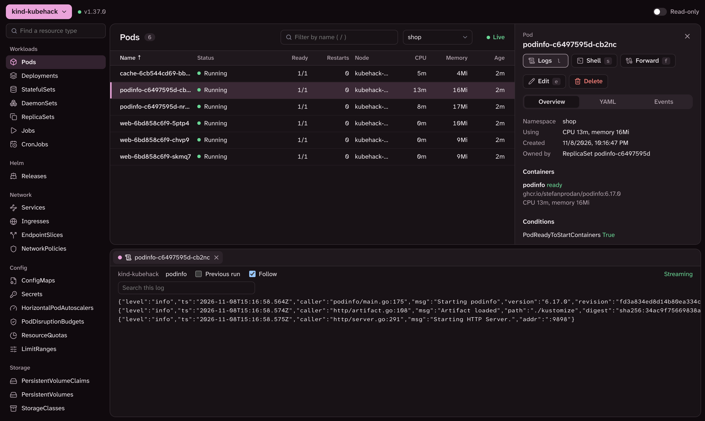
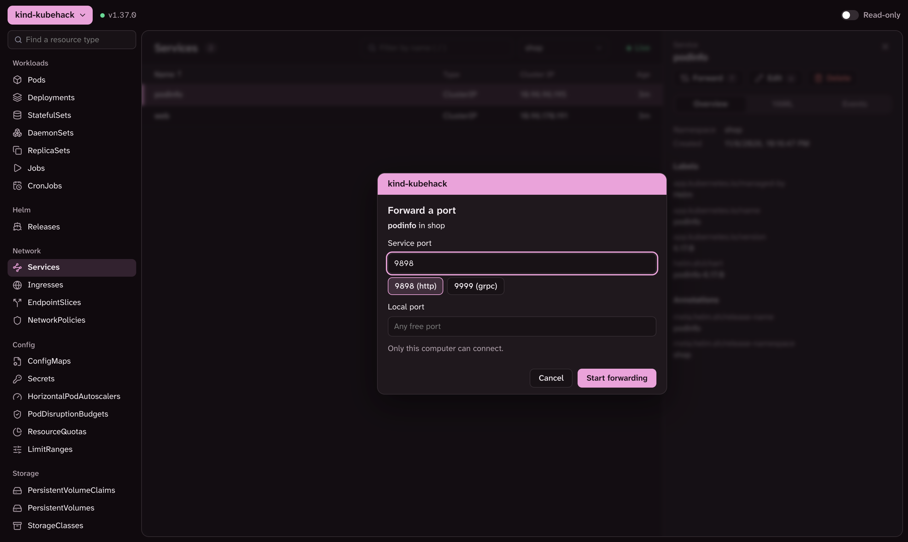
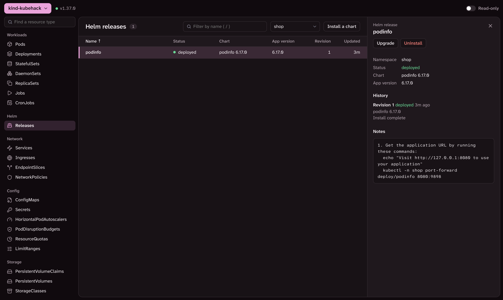

# Kubehack

[](https://github.com/Thadchet/kubehack/actions/workflows/ci.yml)
[](https://github.com/Thadchet/kubehack/releases/latest)
[](LICENSE)

A Kubernetes desktop app. See what's running, read logs, open a shell, forward
ports and manage Helm releases, without typing `kubectl`.

It uses the kubeconfig you already have. Nothing is installed in your cluster, and
there's no account.



## Features

- Browse every resource type, including custom resources, with live updates
- Follow and search pod logs, and open a shell in a container
- Forward ports from pods and services. Kubehack remembers the ports you used
- Edit YAML, or ConfigMap and Secret values as decoded JSON
- Scale, restart and delete, with confirmation
- CPU and memory usage, if the cluster has metrics-server
- Install, upgrade, roll back and uninstall Helm charts
- **Read-only** mode per cluster, enforced by the app, not just hidden buttons

| Forward a port | Helm releases |
| --- | --- |
|  |  |

## Install

If `kubectl get pods` works in your terminal, Kubehack will work too.

### macOS

```sh
brew tap thadchet/tap
brew trust thadchet/tap
brew install --cask kubehack
```

Update with `brew upgrade --cask kubehack`. Works on Apple silicon and Intel.

<details>
<summary>Without Homebrew</summary>

1. Download [kubehack-macos.zip](https://github.com/Thadchet/kubehack/releases/latest/download/kubehack-macos.zip)
   and move `kubehack.app` to Applications.
2. The app isn't notarized yet, so run this once before opening it:

   ```sh
   xattr -dr com.apple.quarantine /Applications/kubehack.app
   ```

</details>

### Windows

Download [kubehack-windows-x64.zip](https://github.com/Thadchet/kubehack/releases/latest/download/kubehack-windows-x64.zip),
extract it and open `kubehack.exe`. If SmartScreen warns you, select **More info**,
then **Run anyway**. The Windows build hasn't been tested on a real PC yet.

### Docker

Runs in your browser instead of a window:

```sh
docker run --rm --pull always -p 127.0.0.1:8765:8765 \
  -v ~/.kube/config:/kube/config:ro \
  -v kubehack:/settings \
  ghcr.io/thadchet/kubehack
```

Open the link it prints. For GKE, use `ghcr.io/thadchet/kubehack:gke` and add
`-v ~/.config/gcloud:/gcloud`.

<details>
<summary>Docker limits</summary>

- Keep `127.0.0.1` in `-p`. The link holds a token that grants your cluster access.
- No port forwards. Use the desktop app or `kubectl port-forward`.
- GKE is the only sign-in plugin included, so EKS and AKS clusters show "Could not reach".
- Certificates must be embedded in the kubeconfig, so minikube's default config doesn't work.
- New clusters need a restart. Helm repos from `helm repo add` aren't available, so use `oci://` charts.
- On Linux, the container can't read your kubeconfig. Clone this repo and run `./run.sh docker`.
- Pin a version with a tag such as `:1.0.3` or `:1.0.3-gke`. To change the port, change
  all three numbers in `-p` and add `-port <n>` after the image name.

</details>

## Usage

1. **Pick a cluster** at the top left. Each cluster gets its own color.
2. **Turn on Read-only** at the top right for clusters such as production. It blocks
   every change, shell and new port forward, and is remembered per cluster.
3. **Pick a resource type** on the left, then click a row to see details, YAML and events.
4. **Act on it** with the buttons in the details panel, or with these keys:

| Key | Action |
| --- | --- |
| `j` `k` or arrows | Move through the table |
| `/` | Filter by name |
| `Esc` | Clear the filter or close the panel |
| `l` `s` `f` `e` | Logs, shell, forward, edit |

Port forwards stop when you quit. Upgrading a Helm release replaces all its values
with what's in the editor, and those values are shown on screen.

## Troubleshooting

| Problem | Fix |
| --- | --- |
| No clusters found | Check `kubectl config get-contexts`, then reopen Kubehack |
| Could not reach a cluster | Check `kubectl get pods`, your VPN and your sign-in, then select **Try again** |
| No CPU or memory | Install [metrics-server](https://github.com/kubernetes-sigs/metrics-server) |
| Could not open a shell | The image has no shell |
| Port already in use | Leave **Local port** empty to get a free one |
| macOS says the app is damaged | Run the `xattr` command above |
| `gke-gcloud-auth-plugin not found` in Docker | Use the `:gke` image |

## Security

Kubehack can do whatever your kubeconfig allows, so use **Read-only** where it
matters. It only connects to your clusters and the chart sources you enter. Its
local API uses a random port and token on every launch, and only accepts requests
from its own window. The downloads aren't signed yet.

Report vulnerabilities as described in [SECURITY.md](SECURITY.md), and everything
else in [GitHub Issues](https://github.com/Thadchet/kubehack/issues). Never paste
kubeconfigs, tokens or Secret values there.

## Uninstall

`brew uninstall --zap --cask kubehack` removes the app and its settings. Otherwise
delete the app and `~/Library/Application Support/kubehack` (Mac) or
`%AppData%\kubehack` (Windows). For Docker, remove the images and run
`docker volume rm kubehack`.

## Contributing

See [CONTRIBUTING.md](CONTRIBUTING.md) to build, test and release Kubehack.

## License

[MIT](LICENSE)
